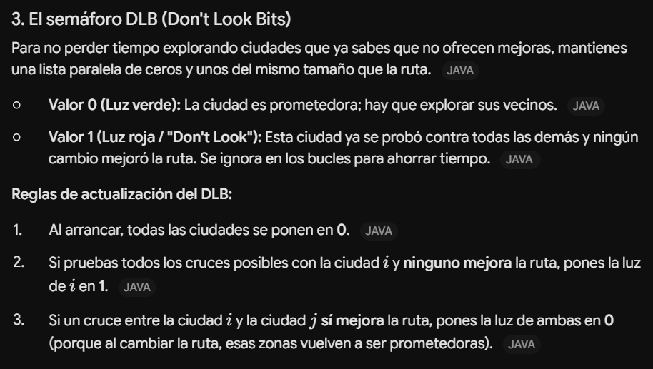
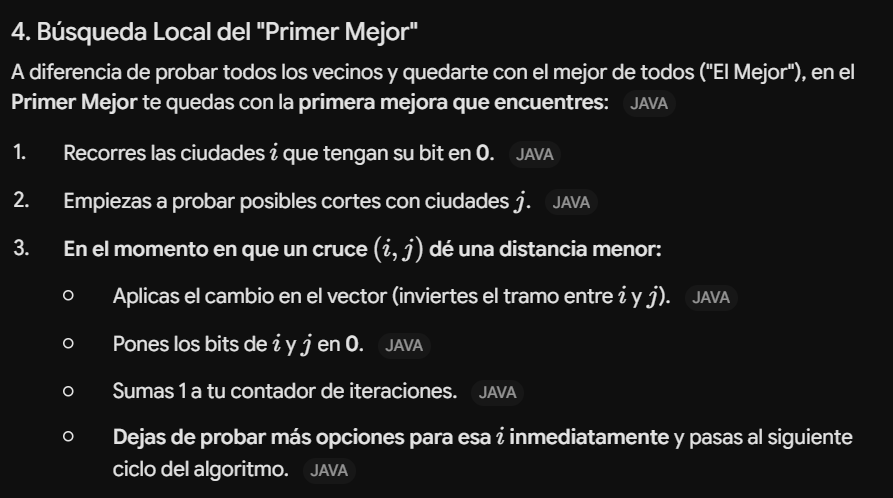
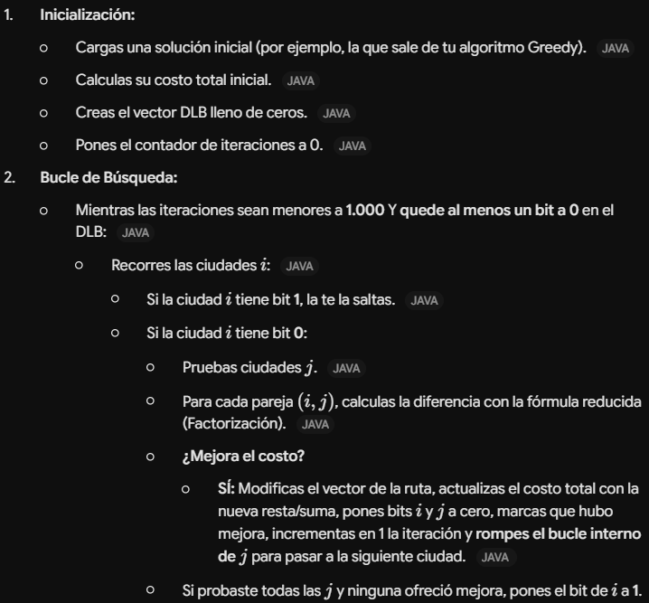

## Busqueda local del primer mejor

---

### Bucle DLB para generar el entorno (2-opt muchas veces)

1. punto inicial
2. bucle del primer mejor

    2.1. si mejora, volver al bucle y cambiar a 1

    2.2. si no, dejar a 0

---

En cada iteración la nueva solución se puede calcular como:

|$F(solución_{nueva})$ = $F(solucion_{inicial})$ - (ARCOS_DESAPARECEN) + (ARCOS_NUEVOS)|
|-|

* Nota: el máximo de iteraciones antes de abandonar es 1.000

---

---

## Explicación del algoritmo trabajando con DLB

---

### Flujo de trabajo del bucle DLB

---

### ¿Que archivos/conceptos nos quedan por ver?

Hemos visto:

* Config.txt
* Rango con semillas

Hay que implementar

* Logs:
 
   Una especie de historico del programa, por cada ejecucion que hace el programa (cada algoritmo) tenemos que hacer un log

* Informe:

   Tomarse la plantilla como el padre nuestro, importante (no)

---

## Búsqueda tabú

[5,3,2,4,1]

Amacenamos en la memoria a corto plazo una lista de pares (o matriz o mapa o lista circular..) el orden y las ciudades con una tenencia tabú de valor '10'

* MCP = {(2,4),(3,4)}

Para la memoria a largo plazo se almacenan los arcos, podemos implementarlo con una matriz o mapa

* pongo un '1' en las posiciones los sitios correspondientes

 Si se llega a un estancamiento.. oscilacion estrategica!
 
## Oscilacion Estrategica
### Intensificacion y diversificacion

#### Intensificacion:

escojo el arco mas visitado (con mas 1) y a partir de ahi cojo los 5 siguientes mas visitados y escojo uno aleatoriamente

#### Diversificacion

escojo alguno de los arcos menos visitado, como habrá muchos, por tanto usanmos un aleatorio para generarlo

## Parametros en Config.txt (y en el informe)

- it = 1000
- t = 10
- o.e = 50%
- estancamiento = ?

## a implementar

* Cambiar a DLB, hace falta: "hay que hacer la busqueda tabú directamente sobre la búsqueda local"
* Movimiento de empeoramiento, cuando el DLB tiene mascara entera a "1", en otras palabras, no hay movimientos mejores, se debe de mover la búsuqeda tabu a el mejor entre los mejores, debe quedar reflejado en el código
* En la BL cuando no se encuentra una solucion buena se para, en la BT se escoge la mejor de las peores
* poner en config.txt los parámetros que faltan y hacer que se lean automaticamente (como el resto de parametros)

LOGS

* un fichero por cada ejecución (15 por cada algoritmo, 5 para el greedy)